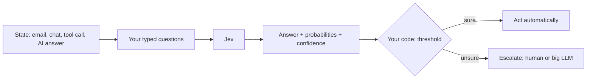
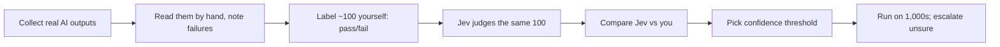

# Jev Roadmap: basics → mastery (focus: MCP + evals)

All links below were checked to exist on 2026-10-07 (the Playground needs a login, so it returns 403 to a plain check). Facts come from the linked pages. Where something is my opinion, it says "opinion". Nothing here has been run yet.

---

## 0. Plain words first

| Word | Plain meaning | Example |
|---|---|---|
| LLM | Large Language Model. A model that writes text | Claude, GPT |
| Jev | TypeSafe's model that **does not write text**. It returns a typed answer + how sure it is | `department = "technical"`, confidence 0.78 |
| System One | "Fast gut decision" (from psychology). Jev's role in software | Route this ticket. Yes/no: is this spam? |
| State | The input you give Jev: text or JSON | A customer email |
| Question | What you ask Jev about the state. 3 types below | "Is this urgent?" |
| Choice | Pick **one** option from a list you define (up to 255) | billing / technical / sales |
| Score | Rate on **ordered** levels you define (2–10 levels) | calm → annoyed → very angry |
| Noul | Yes/no, returned as a **probability** 0 to 1 | `is_urgent = 0.92` |
| Confidence | How sure Jev is about its answer, 0 to 1 | 0.95 = sure, 0.40 = guessing |
| Calibration | When it says 80% sure, it is right ~80% of the time | Lets you trust the number |
| Threshold | The cut-off **your code** picks to act on a number | `if confidence < 0.6: send to human` |
| Escalate | Hand the case to something stronger: a human or a big LLM | Unsure ticket → human queue |
| Cascade | Cheap judge first, expensive judge only for unsure cases | Jev → GPT only when Jev is unsure |
| MCP | Model Context Protocol. A standard plug so an AI agent can call outside tools | Agent calls a `jev_guard_tool_call` tool |
| MCP server | A small program that offers tools over MCP | Your Python server exposing `check_refund` |
| Eval | A repeatable test that scores your AI | 100 tickets with known right answers |
| LLM-as-judge | An AI grades another AI's output | "Is this answer supported by the document? yes/no" |
| Golden dataset | Test cases with right answers labeled by a human | 100 tickets you labeled yourself |
| Guardrail | A check that blocks bad input/output | Block a prompt that tries to steal the system prompt |
| RAG | Retrieval-Augmented Generation. Fetch documents, then let the LLM answer from them | Company policy bot |

**The one trap:** Jev gives a **signal**, not a **decision**. Your code owns the threshold and the action. TypeSafe's own docs say this: keep code in control, give the model narrow decisions ([How to build](https://docs.typesafe.ai/concepts/how-to-build-with-system-one)).

---

## 1. The big picture

Same picture works for **3 jobs**:
1. **Product feature:** route a ticket, block a jailbreak.
2. **MCP agent step:** agent asks "is this tool call safe?" before acting.
3. **Eval judge:** grade 1,000 AI answers cheaply; only unsure ones go to a big LLM or a human.

---

## 2. Industry problems Jev fits (and does not fit)

**Fits** (verdict can be read from the text):

| # | Problem | Who has it | Jev question type |
|---|---|---|---|
| 1 | Support ticket triage | Every SaaS support team | Choice + Score + Noul |
| 2 | Intent routing / model routing | Chatbots, AI gateways | Choice |
| 3 | Input/output guardrails (jailbreak, PII, policy) | Any LLM app | Noul + Score |
| 4 | Agent tool-call approval | Agents that move money, delete data | Choice (allow / confirm / deny) |
| 5 | RAG passage filtering + re-ranking | Search, policy bots | Noul / Score |
| 6 | Citation / claim checking | Research agents, report writers | Choice / Noul |
| 7 | Content moderation | Social, marketplaces | Choice + Noul |
| 8 | LLM-as-judge for evals | Every AI team | Noul / Choice |

Sources: [use-case map](https://docs.typesafe.ai/concepts/use-case-map), [guardrails cookbook](https://docs.typesafe.ai/cookbooks/llm_guardrails), [RAG passages cookbook](https://docs.typesafe.ai/cookbooks/classifying_rag_passages.md), [citation check cookbook](https://docs.typesafe.ai/cookbooks/citation_check.md), [re-ranking cookbook](https://docs.typesafe.ai/cookbooks/rerank_typesafe.md), [community playbook](https://github.com/Anil-matcha/awesome-jev-by-typesafe).

**Does not fit well:**
- Answers that must be **worked out** (math, code correctness, logic). The JEV-as-a-Judge paper found Jev falls behind there ([arXiv 2609.26550](https://arxiv.org/abs/2609.26550)).
- Writing text. Jev never writes text.
- Images, audio, video. Text only ([Models page](https://docs.typesafe.ai/models.md)).
- Non-English is weaker; test first ([Models page](https://docs.typesafe.ai/models.md)).
- Known weak spots per version: [Jev 1.13 jaggedness](https://docs.typesafe.ai/model-jaggedness/jev-1.13.md).

---

## 3. Key numbers (from official docs)

| Thing | Value | Source |
|---|---|---|
| Model | `jev-1.13.0` (alias `jev-latest`) | [Models](https://docs.typesafe.ai/models.md) |
| Price | $0.042 per million **input** tokens; output free | [Models](https://docs.typesafe.ai/models.md) |
| Context | 64k tokens per request | [Models](https://docs.typesafe.ai/models.md) |
| Rate limit | 100K tokens/s, 80 requests/s (can change) | [Models](https://docs.typesafe.ai/models.md) |
| Typical latency | ~0.15–0.2 s median | [paper](https://arxiv.org/abs/2609.26550), [jev-eval](https://github.com/4esv/jev-eval) |

Note: some third-party sites list other prices. Trust `docs.typesafe.ai`.

---

## 4. Levels

### Level 1: Basics (week 1)
- Understand: state, Choice, Score, Noul, confidence.
- Try the free [Playground](https://console.typesafe.ai/playground) with a support email. No code.
- **Read:** [Introduction](https://docs.typesafe.ai/introduction.md), [Primitives](https://docs.typesafe.ai/primitives), [Confidence](https://docs.typesafe.ai/confidence), [Quick start](https://docs.typesafe.ai/introduction/quickstart.md).
- **Done when:** you can explain why a Score is not the same as a Choice, and what confidence 0.4 means.

### Level 2: First code (week 2)
- `pip install typesafe-sdk`, set `TYPESAFE_API_KEY`.
- **Build:** `triage.py`. Classify one ticket: department (Choice), frustration (Score), urgent (Noul). Print the answers.
- **Read:** [Python SDK](https://docs.typesafe.ai/sdk/python.md), [State](https://docs.typesafe.ai/concepts/state.md).
- **Done when:** you print real answers and probabilities for 5 tickets.

### Level 3: Patterns: code stays in control (weeks 3–4)
- **Confidence gate:** act when sure, send to human when not.
- **Fan-out:** ask many questions in one call (cheaper and faster than many calls).
- **Composite scoring:** split a big judgment into small scores; combine with weights in code.
- **Build:** a ticket router with a `human_review` path.
- **Read:** [Confidence-gated routing](https://docs.typesafe.ai/patterns/confidence-routing), [Fan-out](https://docs.typesafe.ai/patterns/fan-out), [Composite scoring](https://docs.typesafe.ai/patterns/composite-scoring.md), [Intent routing](https://docs.typesafe.ai/patterns/intent-routing).
- **Done when:** you can say why your threshold is 0.6 and not 0.9 (the cost of a wrong action vs. the cost of a human review).

### Level 4: Jev + MCP (weeks 5–7) ← your main area
Two directions:

**4a. Use a ready Jev MCP server inside an agent.**
- Connect an agent (Claude Code, Codex, …) to a Jev MCP server. Watch when the agent calls it.
- Examples: [jev-mcp](https://github.com/jkudish/jev-mcp), [jev-judge-mcp](https://github.com/PyModel/jev-judge-mcp), [jevai.org MCP](https://www.jevai.org/mcp) (third-party, not on typesafe.ai).

**4b. Build your own MCP server that wraps Jev.** (opinion: this is where you learn the most)
- **Build:** `jev-guard-mcp`. One tool `guard_tool_call(tool, action, side_effects, reversible)` → returns `allow` / `confirm` / `deny`.
- Then a second tool: `check_claim(claim, evidence)` → `supported` / `not_supported` / `unsure`.
- The **policy** (thresholds, "refunds over $500 need a human") lives in your server code, not in Jev.
- **Read:** [MCP intro](https://modelcontextprotocol.io/docs/getting-started/intro), [Function calling cookbook](https://docs.typesafe.ai/cookbooks/function_calling.md), [Skill suggestion cookbook](https://docs.typesafe.ai/cookbooks/skill_suggestion.md), [jev-browser](https://github.com/Ying-Kai-Liao/jev-browser) (LLM plans, Jev decides).
- **Done when:** an agent calls your MCP tool, a risky action gets `deny`, a safe one gets `allow`, an unclear one gets `confirm`.

### Level 5: Jev for evals (weeks 8–10)
The industry eval loop (from Hamel Husain, Anthropic):

- One judge question per failure type. Yes/no, not 1–10 scales (Hamel's advice).
- Measure agreement with **your** labels. Not just accuracy: how many real failures did Jev catch? How many false alarms?
- **Build:** `jev-judge-eval`. Judge RAG answers: "Is the answer supported by the passage?" Compare Jev with your labels.
- **Read:** [Hamel: LLM-as-judge guide](https://hamel.dev/blog/posts/llm-judge), [Hamel: Evals FAQ](https://hamel.dev/blog/posts/evals-faq), [Anthropic: Demystifying evals for AI agents](https://www.anthropic.com/engineering/demystifying-evals-for-ai-agents), [Snowflake: LLM judges for RAG triad](https://www.snowflake.com/en/blog/engineering/benchmarking-LLM-as-a-judge-RAG-triad-metrics/).
- **Study:** [jev-eval](https://github.com/4esv/jev-eval). It benchmarks Jev vs GPT on accuracy, calibration, latency, cost. Its lesson: a model trained on a benchmark looks great on that benchmark and worse elsewhere.
- **Done when:** you can say "Jev agrees with me on X% of passes and catches Y% of failures."

### Level 6: Cascade judge (weeks 11–12)
- Jev judges first. If confidence ≥ threshold, accept. Else ask a big LLM (or a human).
- Paper result: this cascade beat GPT-6 alone by 0.9 points at 41% of the cost; Jev alone came within 3 points of GPT-6 at 0.36% of the fee where the verdict can be read from text ([arXiv 2609.26550](https://arxiv.org/abs/2609.26550)).
- **Freeze the threshold before** testing on new data. Otherwise you cheat yourself.
- **Build:** add the cascade to `jev-judge-eval`; report accuracy, cost, % escalated.
- **Read:** [SDE cascade cookbook](https://docs.typesafe.ai/cookbooks/sde_cascade.md), [Self-consistency nouls](https://docs.typesafe.ai/cookbooks/consistency_noul_cookbook.md).

### Level 7: Production (weeks 13–15)
- **Pin the model version** (`jev-1.13.0`, not `jev-latest`) once thresholds are tuned. Aliases move ([Models](https://docs.typesafe.ai/models.md)).
- Log every decision: input, answer, confidence, model version, what your code did.
- Handle 429 rate limits and timeouts. Decide the safe default when Jev is down (opinion: deny / send to human for risky actions).
- Keep the judge as an **advisor, not an oracle**: hard checks in code must be able to overrule it. A production study found judges fooled by cached answer keys, wrong labels, and broken parsers ([arXiv 2609.02246](https://arxiv.org/abs/2609.02246)).
- Re-run your eval when the model version changes.

### Level 8: Mastery
- You can say **how much to trust each number**: judge error rate, sample size, calibration plot.
- You know when **not** to use Jev (math/code/logic, non-English, images).
- You can compare Jev against open clones on your data ([openjev](https://github.com/TheoLeeCJ/openjev), [jev-eval](https://github.com/4esv/jev-eval)).
- **Capstone:** an MCP agent + Jev tool guard + Jev cascade eval report, with a written cost/accuracy table.

---

## 5. Project list (in order)

| # | Project | Level | Teaches |
|---|---|---|---|
| 1 | `triage.py` | 2 | Choice / Score / Noul, SDK |
| 2 | Ticket router with human review | 3 | Confidence gate, fan-out |
| 3 | RAG passage filter | 3 | Noul thresholds |
| 4 | `jev-guard-mcp` (your own MCP server) | 4 | MCP + tool-call safety |
| 5 | `jev-judge-eval` | 5 | LLM-as-judge, golden data, agreement |
| 6 | Cascade judge | 6 | Cost vs accuracy |
| 7 | Capstone: agent + guard + eval report | 7–8 | Everything |

---

## 6. All sources

**Official (TypeSafe)**
- Docs index: https://docs.typesafe.ai/llms.txt
- Quick start: https://docs.typesafe.ai/introduction/quickstart.md
- Primitives: https://docs.typesafe.ai/primitives
- Confidence: https://docs.typesafe.ai/confidence
- Models + pricing: https://docs.typesafe.ai/models.md
- Patterns: https://docs.typesafe.ai/patterns/fan-out, https://docs.typesafe.ai/patterns/confidence-routing, https://docs.typesafe.ai/patterns/intent-routing
- Guardrails cookbook: https://docs.typesafe.ai/cookbooks/llm_guardrails

**Papers**
- JEV-as-a-Judge: https://arxiv.org/abs/2609.26550
- LLM-as-a-Judge Is Not an Oracle: https://arxiv.org/abs/2609.02246

**Engineering blogs (evals)**
- Hamel, LLM-as-judge: https://hamel.dev/blog/posts/llm-judge
- Hamel + Shreya, Evals FAQ: https://hamel.dev/blog/posts/evals-faq
- Anthropic, agent evals: https://www.anthropic.com/engineering/demystifying-evals-for-ai-agents
- Snowflake, RAG judges: https://www.snowflake.com/en/blog/engineering/benchmarking-LLM-as-a-judge-RAG-triad-metrics/

**MCP**
- MCP intro: https://modelcontextprotocol.io/docs/getting-started/intro

**Community projects (unofficial)**
- Playbook: https://github.com/Anil-matcha/awesome-jev-by-typesafe
- Showcase: https://github.com/cobusgreyling/Jev
- Examples via OpenRouter: https://github.com/rajivkuriakose/typesafe-jev-examples
- jev-mcp: https://github.com/jkudish/jev-mcp
- jev-judge-mcp: https://github.com/PyModel/jev-judge-mcp
- jev-browser: https://github.com/Ying-Kai-Liao/jev-browser
- jev-eval: https://github.com/4esv/jev-eval
- openjev: https://github.com/TheoLeeCJ/openjev
